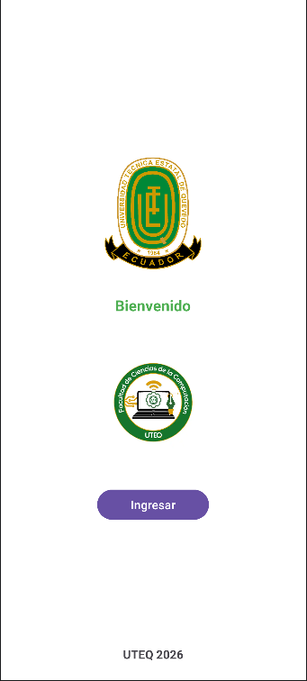
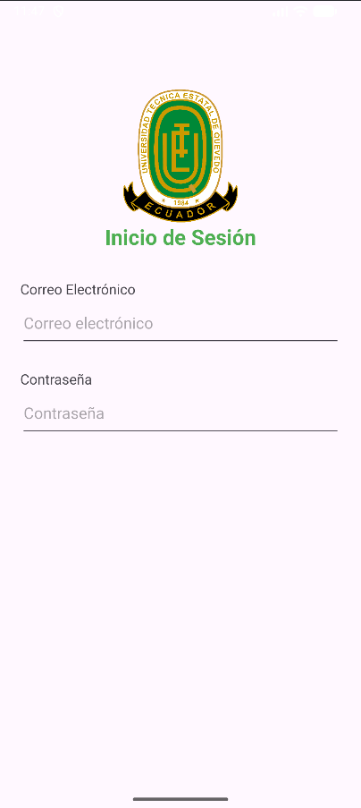

# Pantallas UTEQ

Aplicación Android sencilla con una pantalla de bienvenida y una maqueta de inicio de sesión, inspiradas en la Universidad Técnica Estatal de Quevedo y su Facultad de Ciencias de la Computación y Diseño Digital.

**Estudiante:** Loor Medranda Marlon  
**Correo:** mloorm14@uteq.edu.ec

## Cómo ejecutar

Abre el proyecto en Android Studio, espera la sincronización de Gradle y ejecuta la aplicación en un emulador o dispositivo Android. Pulsa **Ingresar** para ver la segunda pantalla y usa Atrás para volver.

## Capturas de pantalla

| Bienvenida | Inicio de sesión |
|:---:|:---:|
|  |  |

## Archivos principales

- `app/src/main/res/layout/activity_main.xml`: diseño de la bienvenida.
- `app/src/main/res/layout/activity_login.xml`: diseño del inicio de sesión.
- `MainActivity.java`: abre la segunda pantalla al pulsar el botón.
- `LoginActivity.java`: muestra la pantalla de inicio de sesión.

Los logos fueron proporcionados para esta actividad. El formulario es únicamente una maqueta: no inicia sesión ni envía datos.
